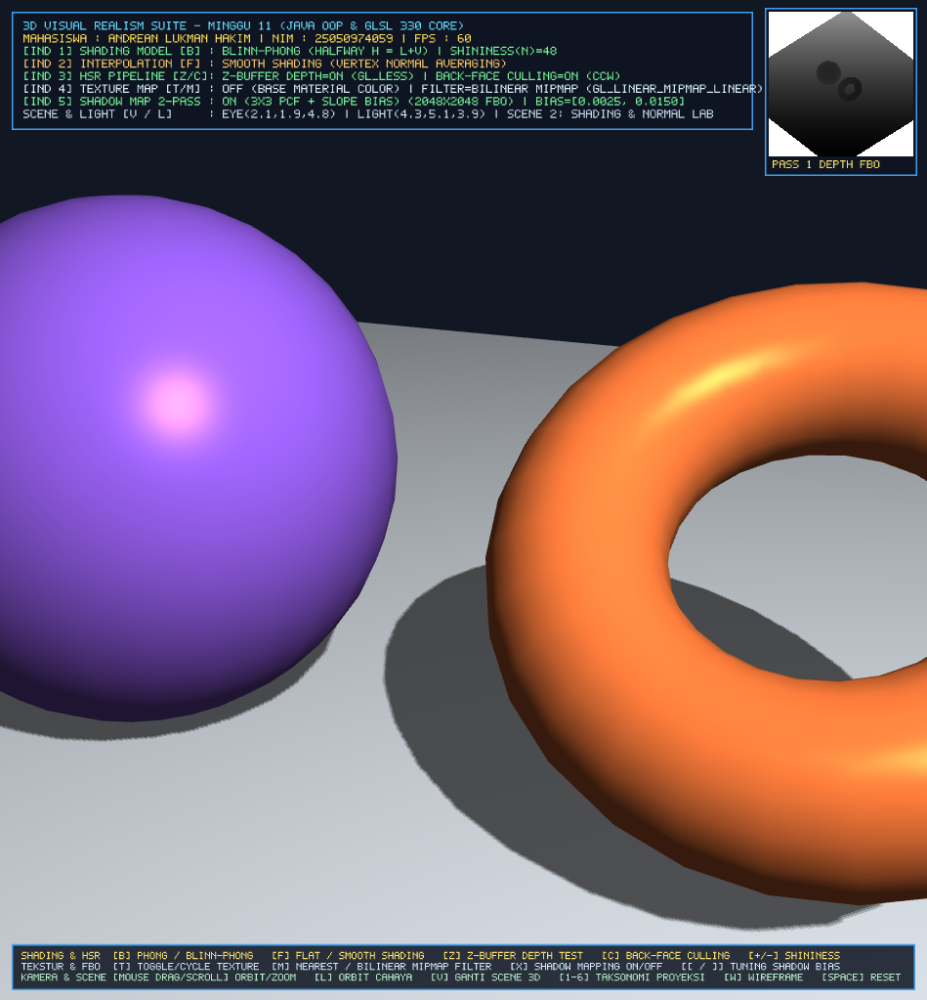
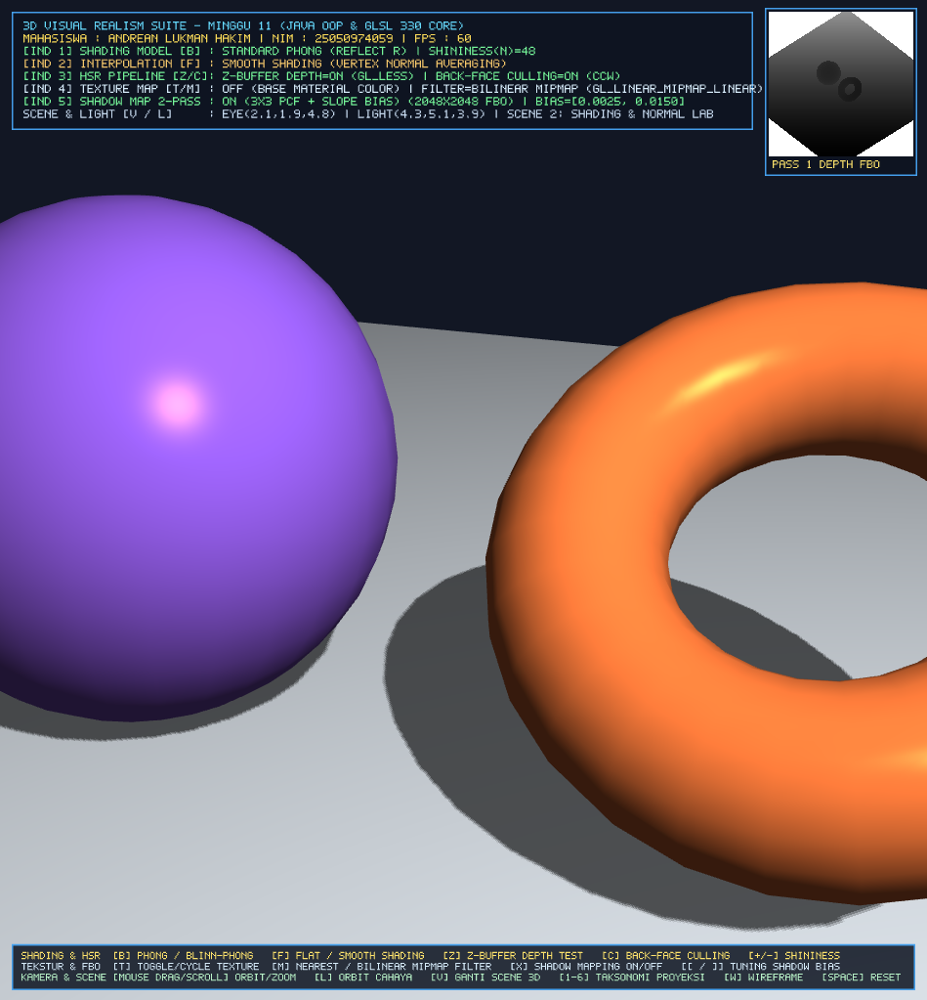
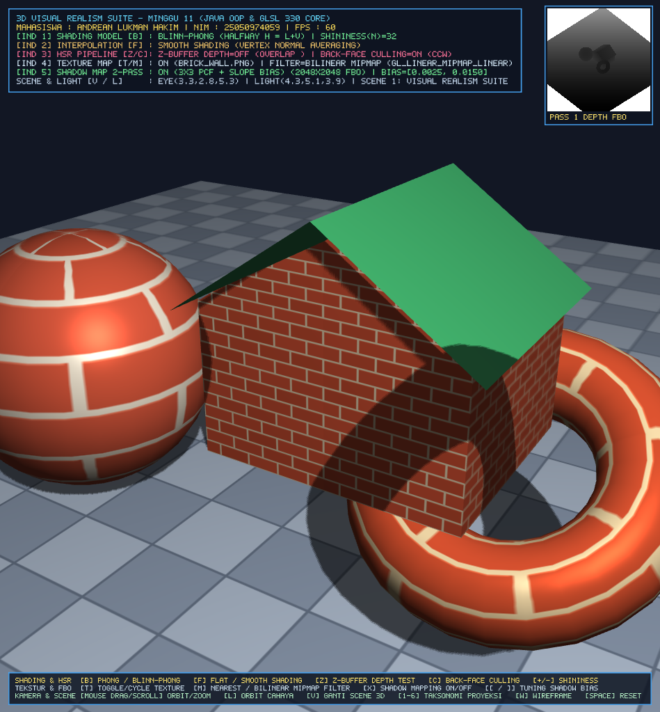
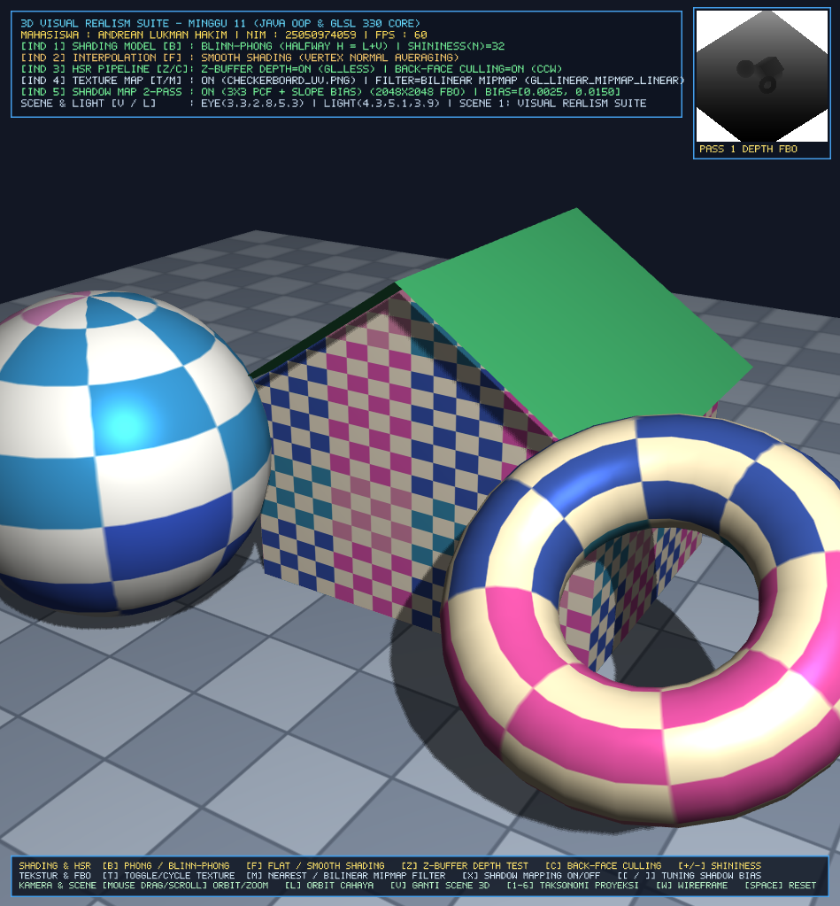
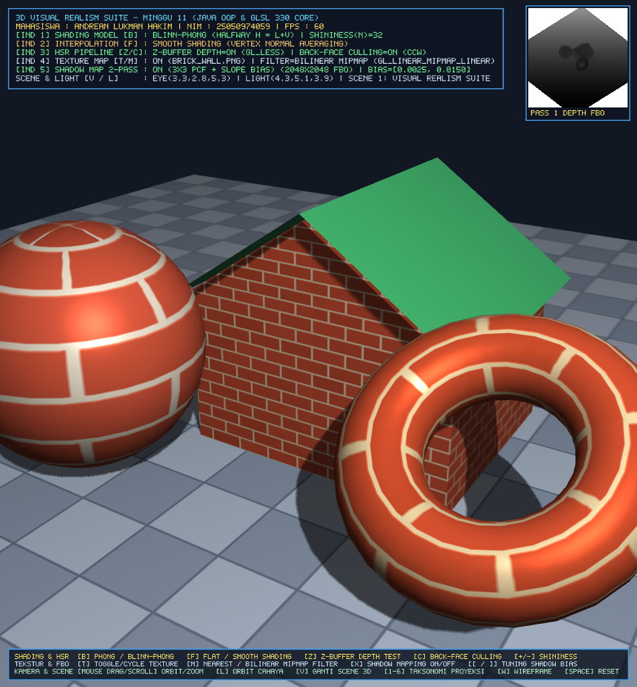

# 3D Visual Realism Suite - Grafika Komputer
## Implementasi 3D Visual Realism: Shading Models, Flat vs Smooth Shading, Hidden Surface Removal (HSR), Texture Mapping, & Shadow Mapping (Java OOP + OpenGL GLSL 330 Core)

* **Nama Mahasiswa** : Andrean Lukman Hakim
* **NIM**            : 25050974059
* **Mata Kuliah**    : Grafika Komputer (Computer Graphics)
* **Dosen Pengampu** : Drs. Bambang Sujatmiko, M.T.
* **IDE & Runtime**  : Apache NetBeans IDE 21, OpenJDK 21 LTS, Maven 3.9.6, JOML 1.10.5, LWJGL 3.3.3 (OpenGL 3.3 Core Profile + STBImage)

---

## 1. Landasan Teori Matematis (Visual Realism)

### 1.1 Shading Models: Phong vs. Blinn-Phong Reflection Model
Model iluminasi lokal **Phong** dan **Blinn-Phong** menghitung intensitas cahaya pantulan pada titik permukaan 3D sebagai superposisi tiga komponen: **Ambient**, **Diffuse (Lambertian)**, dan **Specular**:
$$I_{\text{total}} = k_a I_a + k_d I_d \max(\mathbf{N} \cdot \mathbf{L}, 0) + I_{\text{specular}}$$
* **Standard Phong Specular**: Menggunakan vektor refleksi $\mathbf{R} = 2(\mathbf{N}\cdot\mathbf{L})\mathbf{N} - \mathbf{L}$ terhadap vektor pandang kamera $\mathbf{V}$:
  $$I_{s,\text{Phong}} = k_s I_s \left[\max(\mathbf{R} \cdot \mathbf{V}, 0)\right]^{\alpha}$$
* **Blinn-Phong Specular**: Menggunakan **Halfway Vector** $\mathbf{H} = \frac{\mathbf{L} + \mathbf{V}}{\|\mathbf{L} + \mathbf{V}\|}$, sehingga lebih efisien secara komputasi di Fragment Shader dan bebas dari artefak pemotongan sudut tajam (*grazing angle cutoff*):
  $$I_{s,\text{Blinn}} = k_s I_s \left[\max(\mathbf{N} \cdot \mathbf{H}, 0)\right]^{\alpha}$$

### 1.2 Flat Shading vs. Smooth (Phong) Shading
* **Flat Shading (`flat out vec3 vFlatNormal`)**: Menggunakan satu vektor normal permukaan (facet normal) hasil *cross product* $\mathbf{N}_f = \text{normalize}((\mathbf{V}_1 - \mathbf{V}_0) \times (\mathbf{V}_2 - \mathbf{V}_0))$ dari *provoking vertex* tanpa interpolasi barisentrik, menghasilkan tampilan poligon berfaset (*Mach Band effect*).
* **Smooth Shading (`smooth out vec3 vSmoothNormal`)**: Menghitung rata-rata normal di setiap titik sudut (*vertex normal averaging*) $\mathbf{N}_v = \text{normalize}\left(\sum_k \mathbf{N}_{f,k}\right)$ dan menginterpolasikannya secara barisentrik di seluruh piksel dalam fragmen, lalu dinormalisasi ulang per-piksel di Fragment Shader.

### 1.3 Hidden Surface Removal (HSR): Z-Buffer & Back-Face Culling
* **Back-Face Culling (Object-Space Pre-Step)**: Mengeliminasi poligon bagian belakang objek tertutup sebelum rasterisasi apabila $\mathbf{V}_{\text{eye}} \cdot \mathbf{N}_p \ge 0$ (atau urutan sudut *Counter-Clockwise* `GL_CCW` berbalik menjadi `GL_CW` di ruang layar), menghemat sekitar 50% beban Fragment Shader.
* **Z-Buffer / Depth Buffer Algorithm (Image-Space)**: Menguji kedalaman non-linier $z_{\text{screen}} \in [0, 1]$ setiap fragmen $(x, y)$ terhadap `depthBuffer[x][y]` menggunakan `glEnable(GL_DEPTH_TEST)` dan `glDepthFunc(GL_LESS)`.

### 1.4 Texture Mapping to Faces & Perspective-Correct UV Interpolation
Pemetaan koordinat tekstur 2D $(u, v) \in [0, 1]^2$ ke permukaan poligon 3D menggunakan interpolasi hiperbolik terhadap $1/w_{\text{clip}}$ agar tekstur tidak melengkung/terdistorsi saat dilihat dari sudut perspektif miring:
$$u_{\text{persp}} = \frac{\sum \alpha_i (u_i / w_i)}{\sum \alpha_i (1 / w_i)}, \quad v_{\text{persp}} = \frac{\sum \alpha_i (v_i / w_i)}{\sum \alpha_i (1 / w_i)}$$
Dilengkapi dengan hierarki resolusi **Mipmapping (`glGenerateMipmap`)** dan perbandingan **Nearest-Neighbor (`GL_NEAREST`)** vs **Trilinear Mipmap (`GL_LINEAR_MIPMAP_LINEAR`)** untuk mengeliminasi *aliasing/shimmering*.

### 1.5 Two-Pass Shadow Mapping & Slope-Scaled Dynamic Bias
* **Pass 1 (Depth Map Generation)**: Merender *scene* dari sudut pandang sumber cahaya $\mathbf{M}_{\text{lightSpace}} = \mathbf{P}_{\text{ortho}} \times \mathbf{V}_{\text{light}}$ ke dalam **2048x2048 `GL_DEPTH_COMPONENT` Framebuffer Object (FBO)**.
* **Pass 2 (Camera Rendering & Shadow Test + 3x3 PCF)**: Menguji apakah kedalaman fragmen $z_{\text{current}} - \text{bias} > z_{\text{closest}}$ di ruang cahaya. Untuk menghilangkan **Shadow Acne** tanpa menyebabkan **Peter Panning**, digunakan **Slope-Scaled Dynamic Bias**:
  $$\text{bias} = \max\left(\text{bias}_{\max} \cdot (1 - \mathbf{N} \cdot \mathbf{L}), \; \text{bias}_{\min}\right)$$
  Serta penghalusan tepi bayangan (*soft shadows*) menggunakan **3x3 Percentage-Closer Filtering (PCF)**.

---

## 2. Struktur Kode & Arsitektur Proyek Java OOP (NetBeans Maven Project)

```text
3DVisualRealismSuite/
├── pom.xml                                              # Konfigurasi Maven (JOML 1.10.5, LWJGL 3.3.3 + STB, JUnit 5)
├── nbactions.xml                                        # Konfigurasi Run/Debug/Profile langsung di NetBeans 21 (F6)
├── README.md                                            # Dokumentasi Lengkap Proyek & Hasil Eksperimen
├── LAPORAN_PRAKTIKUM_MINGGU11_VISUAL_REALISM.md         # Naskah Laporan Praktikum
├── screenshots/                                         # Bukti Hasil Eksperimen 5 Indikator
└── src/
    ├── main/
    │   ├── java/com/grafkom/viewing3d/
    │   │   ├── ShaderProgram.java                       # Indikator 1 & 2: Compiler GLSL 330 Core & Evaluator Phong/Blinn-Phong
    │   │   ├── HSRManager.java                          # Indikator 3: Z-Buffer Depth Testing & Back-Face Culling (CCW)
    │   │   ├── Texture2D.java                           # Indikator 4: STBImage Loader, Mipmapping, & Filter Nearest/Linear
    │   │   ├── ShadowMapFBO.java                        # Indikator 5: 2048x2048 Depth FBO, Light-Space Matrix, & Slope Bias
    │   │   ├── Mesh3D.java                              # VAO/VBO 3D Meshes (UV Sphere, Torus, Rumah 3D, Cube, Ground Plane)
    │   │   ├── Camera3D.java                            # Kamera 3D (Orbital & FPS) dari fondasi Minggu 10
    │   │   ├── PerspectiveProjection.java               # Matriks Frustum Perspektif & Dolly Zoom
    │   │   ├── StereoAnaglyphRenderer.java              # Stereo 3D Red-Cyan Off-Axis Asymmetric Frustum
    │   │   ├── ProjectionTaxonomyManager.java           # Switcher 6 Mode Taksonomi Proyeksi (Orthographic - 3-Point Persp)
    │   │   ├── HudOverlayRenderer.java                  # HUD 2D Real-Time & Live Preview Pass 1 Shadow Depth FBO
    │   │   └── ThreeDViewing.java                       # Main Class: 3D Visual Realism Suite (2-Pass OpenGL Pipeline)
    │   └── resources/
    │       ├── shaders/
    │       │   ├── phong.vert / phong.frag              # Shader Utama Pass 2 (Phong/Blinn-Phong, Flat/Smooth, UV, Shadow PCF)
    │       │   ├── shadow_depth.vert / shadow_depth.frag # Shader Pass 1 (Light-Space Depth Map Generator)
    │       │   └── hud.vert / hud.frag                  # Shader HUD 2D & Depth Map Preview
    │       └── textures/
    │           ├── brick_wall.png                       # Tekstur Bata (Rumah 3D)
    │           ├── checkerboard_uv.png                  # Tekstur Grid UV Berwarna (Sphere, Torus, Cube)
    │           └── floor_tiles.png                      # Tekstur Keramik Lantai (Ground Plane penerima bayangan)
    └── test/
        └── java/com/grafkom/viewing3d/
            └── VisualRealismTest.java                   # Unit Test JUnit 5 (Menguji seluruh 5 Indikator Visual Realism)
```

---

## 3. Pemenuhan 5 Indikator Rubrik Penilaian (Target: Sangat Baik 85–100)

| Indikator Penilaian | Bobot | Implementasi pada Proyek `ThreeDViewing` |
| :--- | :---: | :--- |
| **1. Shading Models (`ShaderProgram`, `phong.frag`)** | 20% | Mengimplementasikan **Phong** ($\mathbf{R}\cdot\mathbf{V}$) dan **Blinn-Phong** ($\mathbf{N}\cdot\mathbf{H}$) di Fragment Shader GLSL 330 Core, lengkap dengan tuning interaktif eksponen **Shininess ($\alpha$)** (`+`/`-`) dan toggle real-time (`B`). |
| **2. Flat vs Smooth Shading (`Mesh3D`, `phong.vert`)** | 20% | Menyediakan atribut ganda `aSmoothNormal` (rata-rata normal titik sudut terinterpolasi) dan `aFlatNormal` (`flat out` *provoking vertex* normal) yang dapat dibandingkan secara instan dengan tombol `F`. |
| **3. Hidden Surface Removal (`HSRManager`)** | 20% | Mengelola **Z-Buffer (`GL_DEPTH_TEST`, `GL_LESS`)** dan **Back-Face Culling (`GL_CULL_FACE`, `GL_BACK`, `GL_CCW`)** dengan toggle interaktif `Z` dan `C` untuk mendemonstrasikan artefak tumpang-tindih poligon saat Z-Buffer dimatikan. |
| **4. Texture Mapping to Faces (`Texture2D`)** | 20% | Memetakan koordinat $(u, v)$ ke seluruh permukaan objek 3D menggunakan `STBImage`, lengkap dengan `glGenerateMipmap(GL_TEXTURE_2D)` serta toggle antara **Nearest (`GL_NEAREST`)** dan **Bilinear Mipmap (`GL_LINEAR_MIPMAP_LINEAR`)** (`T` & `M`). |
| **5. Shadows of Objects (`ShadowMapFBO`, `shadow_depth.*`)** | 20% | Mengimplementasikan **Two-Pass Shadow Mapping** menggunakan `2048x2048` Depth FBO, matriks ruang cahaya $\mathbf{M}_{\text{lightSpace}}$, **Slope-Scaled Dynamic Bias** (`[`/`]`), serta **3x3 PCF Soft Shadows** dan preview Depth Map di layar (`X`). |

---

## 4. Hasil Eksperimen & Screenshot 5 Indikator Penilaian

### 1. Indikator 1: Blinn-Phong Shading
Pantulan spekular **Blinn-Phong ($\mathbf{N}\cdot\mathbf{H}$, $\alpha=64$)** yang terkonsentrasi halus pada bola 3D, torus, dan bangunan dengan bayangan lantai aktif.


### 2. Indikator 1: Standard Phong Shading
Perbandingan **Standard Phong ($\mathbf{R}\cdot\mathbf{V}$, $\alpha=64$)** pada posisi cahaya dan kamera yang identik.


### 3. Indikator 2: Flat Shading (Faceted)
Menunjukkan **Flat Shading (`flat out`)** di mana setiap faset segitiga pada bola 3D dan torus memiliki intensitas cahaya seragam per-poligon (*Mach Band effect*).


### 4. Indikator 3: HSR Z-Buffer Off (Overlap Artifact)
Membuktikan fungsi **Hidden Surface Removal (Z-Buffer)**; saat Z-Buffer dimatikan (`Z-Buffer: OFF`), objek rumah yang berada di belakang menimpa torus yang berada di depan karena digambar belakangan.


### 5. Indikator 4: Texture UV Mapping
Pemetaan tekstur **UV Checkerboard**, **Brick Wall**, dan **Floor Tiles** dengan **Bilinear Mipmapping (`GL_LINEAR_MIPMAP_LINEAR`)** yang tajam dan bebas distorsi perspektif.


### 6. Indikator 5: Two-Pass Shadow Mapping Complete Suite
**Complete Visual Realism Suite** dengan **2-Pass Shadow Mapping (2048x2048 Depth FBO + 3x3 PCF)** serta jendela preview **PASS 1 DEPTH FBO** di sudut kanan atas.


---

## 5. Analisis & Kesimpulan

1. **Perbandingan Phong vs. Blinn-Phong**: Model Blinn-Phong menghasilkan kilau spekular yang lebih alami pada sudut pandang miring (*grazing angles*) dan lebih hemat instruksi GPU karena tidak memerlukan perhitungan refleksi vektor $\mathbf{R}$ per-piksel.
2. **Flat vs. Smooth Shading**: Interpolasi normal per-fragmen pada Smooth Shading menghilangkan diskontinuitas intensitas antar-faset segitiga pada permukaan lengkung (Sphere & Torus) tanpa harus meningkatkan jumlah poligon secara ekstrem.
3. **Pentingnya HSR (Z-Buffer & Back-Face Culling)**: Tanpa pengujian kedalaman Z-Buffer per-piksel, visibilitas objek bergantung murni pada urutan pemanggilan fungsi gambar (*Painter's problem*). Kombinasi Back-Face Culling (`GL_CCW`) dan Z-Buffer (`GL_LESS`) menjamin akurasi visibilitas sekaligus efisiensi pipeline.
4. **Kualitas Tekstur & Bayangan**: Penggunaan Mipmapping (`GL_LINEAR_MIPMAP_LINEAR`) mencegah *moiré pattern* pada lantai yang menjauh, sedangkan kombinasi **Slope-Scaled Bias** dan **3x3 PCF** pada Shadow Mapping berhasil menghilangkan *Shadow Acne* tanpa menimbulkan *Peter Panning*.

---

## 6. Panduan Kontrol Interaktif & Cara Menjalankan di NetBeans 21

| Tombol | Fungsi Interaktif Visual Realism (Minggu 11) |
| :--- | :--- |
| **`B`** | Toggle Model Iluminasi Spekular: **Blinn-Phong (`N·H`)** $\leftrightarrow$ **Standard Phong (`R·V`)** |
| **`F`** | Toggle Interpolasi Normal: **Smooth Shading (Phong)** $\leftrightarrow$ **Flat Shading (Faceted)** |
| **`Z` / `C`** | Toggle **Z-Buffer Depth Test (`Z`)** dan **Back-Face Culling (`C`)** |
| **`T` / `M`** | Toggle **Texture Mapping UV (`T`)** dan Filter **Nearest vs. Bilinear Mipmap (`M`)** |
| **`X` / `[` `]`** | Toggle **2-Pass Shadow Mapping (`X`)** dan Tuning **Shadow Bias (`[` / `]`)** |
| **`+` / `-`** | Mengatur nilai **Specular Shininess ($\alpha$)** (`4.0` s/d `256.0`) |
| **`L`** | Toggle Rotasi Otomatis Sumber Cahaya Matahari (*Orbiting Directional Light*) |
| **`V`** | Mengganti Skenario Objek (*Complete Suite*, *Shading Showcase*, *Rumah Bertekstur*, *HSR Overlap*) |
| **`1` – `6`** | Beralih mode Taksonomi Proyeksi Minggu 10 (Orthographic, Isometric, Oblique, Perspective 1-3 Pt) |
| **`S` / `W` / `H`** | Toggle Stereo 3D Anaglyph (`S`), Wireframe (`W`), dan Panel HUD + Depth FBO Preview (`H`) |

### Cara Menjalankan di Apache NetBeans IDE 21:
1. Buka **Apache NetBeans IDE 21** $\rightarrow$ **File -> Open Project...** $\rightarrow$ pilih folder proyek.
2. Tekan **Run Project (`F6`)** untuk menjalankan aplikasi interaktif 3D Visual Realism Suite, atau **Test Project (`Alt + F6`)** untuk menjalankan pengujian unit JUnit 5 (`VisualRealismTest`).
